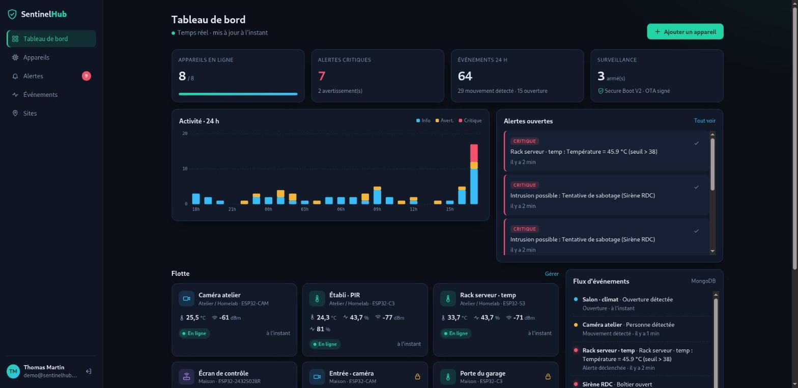

<div align="center">

# 🛡️ SentinelHub

**Plateforme de supervision pour une flotte d'objets connectés ESP32**

[]()
[]()
[]()
[]()
[]()
[]()

</div>

SentinelHub est le back-office web de SentinelOS, mon firmware sécurisé pour ESP32.
Les appareils (capteurs, caméras ESP32-CAM, sirènes, écran de contrôle) envoient leur télémétrie
et leurs événements de sécurité à une API. La plateforme les stocke, les agrège, déclenche des alertes
et affiche le tout en temps réel dans un tableau de bord responsive.



## Fonctionnalités

- **Tableau de bord temps réel** : état de la flotte, indicateurs clés, histogramme d'activité sur 24 h, flux d'événements, acquittement des alertes sans rechargement.
- **API d'ingestion pour les ESP32** : chaque appareil a son propre token Bearer (seul le hash SHA-256 est stocké, et le token n'est affiché qu'une fois).
- **Moteur d'alertes** : règles de seuil par appareil (`température > 38 °C`, `batterie < 20 %`…) avec anti-rebond.
- **Mode armé** : quand un appareil armé détecte un mouvement, une ouverture ou un sabotage, l'événement devient une intrusion critique.
- **Graphiques par métrique** sur 6 h, 24 h, 3 j ou 7 j, avec la moyenne et la plage min/max calculées par MongoDB.
- **Multi-utilisateur** : chacun ne voit et ne gère que ses propres sites et appareils (Voter Symfony).
- **Simulateur de flotte** pour faire vivre la démo sans matériel.

## Stack et choix techniques

### PHP / Symfony 8

| Sujet | Mise en œuvre |
|---|---|
| Architecture | Contrôleurs fins, logique dans des services (`IngestionService`, `AlertEvaluator`), DTO validés |
| API | `#[MapRequestPayload]` + contraintes Validator, réponses 422 normalisées, `#[MapQueryParameter]` |
| Authentification appareils | `ValueResolver` ciblé (`#[ValueResolver('device_token')]`) qui injecte le `Device` authentifié |
| Authentification utilisateurs | SecurityBundle : `form_login`, remember-me, limitation des tentatives (RateLimiter), CSRF |
| Autorisations | `OwnershipVoter` + `#[IsGranted('MANAGE', 'device')]` |
| Formulaires | Form types avec `EnumType`, `EntityType` filtré par propriétaire, thème Twig personnalisé |
| Modèle | Enums PHP typés (`DeviceType`, `Severity`, `Metric`, `Operator`), promoted properties, `readonly` |
| Console | Commande invocable `app:simulate` avec attributs `#[Option]` |
| Tests | PHPUnit : tests unitaires (règles, cooldown, tokens) et fonctionnels HTTP de bout en bout sur les deux bases |

### Deux bases, chacune pour ce qu'elle fait de mieux

```
          ┌─────────────── ESP32 (SentinelOS) ───────────────┐
          │  POST /api/v1/telemetry   POST /api/v1/events    │
          └──────────────────────────┬───────────────────────┘
                                     ▼
                           IngestionService
                   ┌─────────────────┴─────────────────┐
                   ▼                                   ▼
        MySQL · Doctrine ORM                 MongoDB · Doctrine ODM
  users, sites, devices, alert_rules,     telemetry (séries temporelles)
  alerts (état, acquittement)             device_events (journal, payload libre)
  → relationnel, contraintes, transactions → gros volume, schéma souple, TTL, agrégations
```

**MySQL (Doctrine ORM)** stocke les données de référence et l'état métier : clés étrangères avec `ON DELETE CASCADE`, contraintes d'unicité (adresse MAC, hash du token), index composites, requêtes DQL avec jointures pour éviter les requêtes N+1, `UPDATE` en masse pour acquitter toutes les alertes, migrations versionnées.

**MongoDB (Doctrine ODM)** stocke le flux de mesures et d'événements, qui grossit sans cesse :
- index composés (`deviceId` + date) et **index TTL** qui purgent automatiquement la télémétrie après 30 jours et les événements après 180 jours ;
- **pipelines d'agrégation** : séries temporelles avec `$dateTrunc` et `$group` (moyenne, min, max), dernière valeur connue par appareil (`$sort` puis `$first`), histogramme horaire ventilé par sévérité, comptage par type d'événement ;
- champ `payload` libre selon le type d'événement (confiance de détection, zone PIR, raison du redémarrage…).

### JavaScript, HTML, CSS

- **JavaScript natif en modules ES**, chargé par AssetMapper (pas de build, pas de framework).
- **Graphiques SVG faits main** (`assets/js/charts.js`) : courbe avec bande min/max, animation de tracé, infobulle souris et tactile, histogramme empilé. Aucune bibliothèque.
- Rafraîchissement en direct par `fetch`, en pause quand l'onglet est masqué, `AbortController` pour annuler les requêtes obsolètes, dates relatives avec `Intl.RelativeTimeFormat`.
- **CSS moderne sans framework** : variables CSS, `color-mix()`, Grid et Flexbox, thème sombre ou clair selon `prefers-color-scheme`, prise en compte de `prefers-reduced-motion`.
- **Responsive (mobile d'abord)** : menu latéral en tiroir sur mobile, tableaux transformés en cartes sous 760 px, champs en 16 px pour éviter le zoom automatique sur iOS.
- Accessibilité : HTML sémantique, `aria-current`, `aria-selected`, lien d'évitement, focus visible.

## Démarrage rapide

Prérequis : Docker et Docker Compose.

```bash
make install     # conteneurs, dépendances, migrations, index MongoDB, fixtures, 48 h d'historique
make simulate    # optionnel : la flotte envoie des mesures toutes les 5 s
```

Ouvre ensuite **http://localhost:8080** et connecte-toi avec `demo@sentinelhub.dev` / `sentinel2026`.

| Service | Port hôte |
|---|---|
| Application (nginx) | 8080 |
| MySQL | 3307 |
| MongoDB | 27018 |

Autres commandes : `make test`, `make logs`, `make sh`, `make help`.

## API des appareils

L'appareil de démo « Salon · climat » a un token fixe, pour tester avec curl :

```bash
TOKEN=shd_00000000000000000000000000000000000000000000000000000000c0ffee42

# Télémétrie (202 Accepted, avec le nombre d'alertes déclenchées)
curl -X POST http://localhost:8080/api/v1/telemetry \
  -H "Authorization: Bearer $TOKEN" -H "Content-Type: application/json" \
  -d '{"metrics": {"temperature": 31.5, "humidity": 55, "rssi": -60}, "firmware": "1.4.3"}'

# Événement de sécurité (201 Created)
curl -X POST http://localhost:8080/api/v1/events \
  -H "Authorization: Bearer $TOKEN" -H "Content-Type: application/json" \
  -d '{"type": "motion", "severity": "info", "payload": {"zone": 2}}'

# Configuration de l'appareil (armé ?, règles actives)
curl http://localhost:8080/api/v1/me -H "Authorization: Bearer $TOKEN"
```

| Code | Signification |
|---|---|
| `202` / `201` | Mesure ou événement accepté |
| `401` | Token absent ou invalide |
| `422` | Charge utile invalide (détail des violations en JSON) |

Métriques acceptées : `temperature`, `humidity`, `rssi`, `heap`, `battery`. Les clés inconnues sont ignorées.
Types d'événements : `motion`, `door_open`, `tamper`, `boot`, `ota_update`, `auth_failure`.

Un exemple de client ESP-IDF (token lu depuis la NVS chiffrée, TLS vérifié) se trouve dans [`docs/firmware/sentinelhub_client.c`](docs/firmware/sentinelhub_client.c).

## Organisation du code

```
src/
├── Command/SimulateFleetCommand.php   # app:simulate --backfill / --live
├── Controller/                        # pages Twig + Api/ (ingestion, JSON temps réel)
├── Document/                          # MongoDB : TelemetryPoint, DeviceEvent
├── Entity/                            # MySQL : User, Site, Device, AlertRule, Alert
├── Enum/                              # DeviceType, Metric, Operator, Severity
├── Dto/                               # TelemetryInput, EventInput (validation)
├── Form/                              # formulaires Symfony
├── Repository/                        # requêtes DQL et pipelines d'agrégation
├── Security/                          # DeviceTokenManager, OwnershipVoter
├── Service/                           # IngestionService, AlertEvaluator, FleetSimulator
└── ValueResolver/DeviceTokenResolver.php
assets/
├── app.js  js/charts.js  js/dashboard.js  js/device.js  js/time.js
└── styles/app.css
```

## Tests

```bash
make test
```

- **Tests unitaires** : évaluation des règles d'alerte, cooldown, filtrage des métriques, statut en ligne ou hors ligne, normalisation de l'adresse MAC, hachage des tokens.
- **Tests fonctionnels** (bases `sentinelhub_test`) : rejet des tokens invalides (401), validation (422), chaîne complète HTTP → MongoDB + MySQL avec déclenchement d'alerte, passage d'un mouvement en intrusion critique quand l'appareil est armé, redirection vers la connexion.
